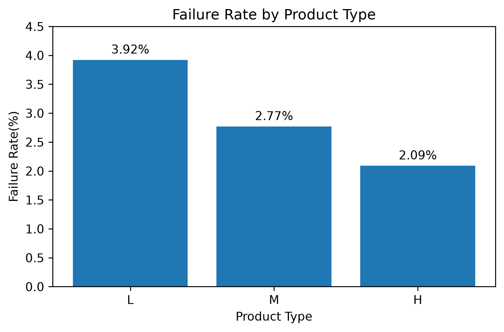
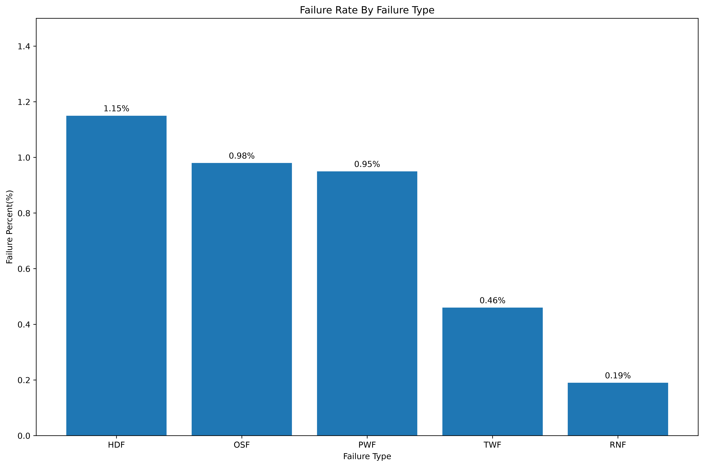
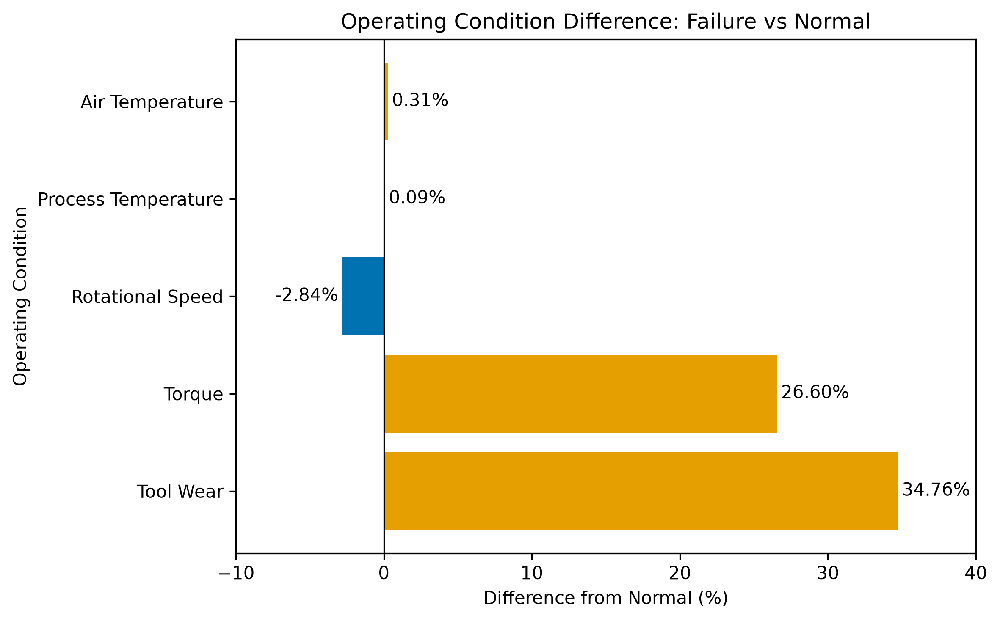
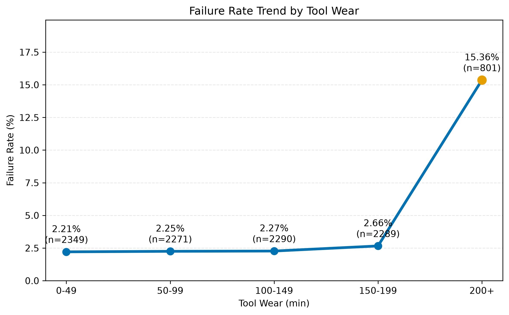
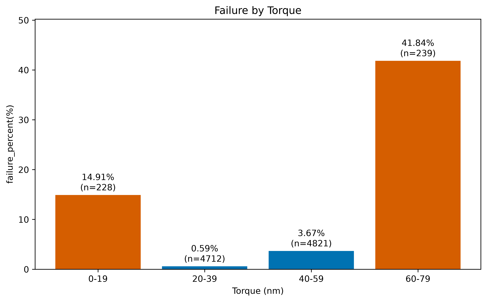

# Industrial Data Analysis

基于 AI4I 2020 预测性维护数据集，使用 Python、Pandas、SQLite 和 Matplotlib 分析工业设备的运行状态与故障特征，通过 FastAPI 提供统计接口，并支持使用 Docker 启动 API 服务。DeepSeek 工具调用命令行可以根据问题选择产品类型、刀具磨损或扭矩统计工具，也支持传入产品类型，只查询 L、M 或 H 类型的统计结果。另有智谱模型报告脚本，支持普通与流式 JSON 报告生成及保存前校验。

## 项目目标

- 使用 Pandas 完成数据读取与处理
- 使用 SQLite 进行分组统计和指标计算
- 分析产品类型、故障类型及运行条件与设备故障的关系
- 使用 Matplotlib 展示分析结果
- 使用 Git 和 GitHub 管理项目版本
- 使用 FastAPI 提供 JSON 接口，通过 Pydantic 校验输入与输出
- 使用 pytest 自动测试 SQL 查询和接口行为
- 根据 SQL 统计生成模型报告，校验格式、数值规则及与查询结果的一致性
- 支持流式正文显示、结束状态检查，以及 token 用量日志记录
- 使用 DeepSeek Tool Calling 根据问题选择统计工具，校验工具参数，执行固定 SQL 后回传结果并生成回答
- 使用 Docker 构建和运行 FastAPI 服务，通过只读挂载访问 SQLite 数据库

## 数据集

项目使用 AI4I 2020 Predictive Maintenance Dataset，共包含 10,000 条设备运行记录。

主要字段包括：

- 产品类型
- 空气温度与加工温度
- 转速
- 扭矩
- 刀具磨损时间
- 设备故障状态
- 不同故障类型

## 技术栈

- Python
- Pandas
- SQLite
- Matplotlib
- FastAPI、Uvicorn
- Pydantic
- pytest、HTTPX（接口测试）
- OpenAI Python SDK（Agent 连接 DeepSeek，报告脚本连接智谱）
- Docker
- Git
- GitHub

## 分析流程

```text
原始 CSV 数据
    ↓
数据清洗与字段规范化
    ↓
写入 SQLite 数据库
    ↓
SQL 分组与指标计算
    ↓
导出分析结果 CSV
    ↓
Pandas 读取结果
    ↓
Matplotlib 数据可视化
```

## 主要分析结果

### 1. 整体故障情况

数据集中共有 10,000 条记录，其中 339 条发生设备故障，整体故障率为 **3.39%**。

### 2. 不同产品类型的故障率

| 产品类型 | 记录数 | 故障数 | 故障率 |
|---|---:|---:|---:|
| L | 6000 | 235 | 3.92% |
| M | 2997 | 83 | 2.77% |
| H | 1003 | 21 | 2.09% |

L 类产品的故障率最高，H 类产品的故障率最低。



### 3. 不同故障类型

| 故障类型 | 故障数 | 占全部记录比例 |
|---|---:|---:|
| HDF | 115 | 1.15% |
| OSF | 98 | 0.98% |
| PWF | 95 | 0.95% |
| TWF | 46 | 0.46% |
| RNF | 19 | 0.19% |

HDF 是出现次数最多的故障类型。不同故障类型可能同时出现在同一条记录中，因此各类故障数之和可能大于设备故障记录总数。



### 4. 正常与故障状态的运行条件

与正常组相比，故障组表现出以下特征：

- 平均扭矩提高约 **26.60%**
- 平均刀具磨损时间提高约 **34.76%**
- 平均转速降低约 **2.84%**
- 温度差异相对较小



### 5. 刀具磨损与故障率

刀具磨损低于 200 分钟时，故障率约为 `2.21%–2.66%`。

当刀具磨损达到 200 分钟以上时，故障率上升至 **15.36%**。



### 6. 扭矩与故障率

| 扭矩区间 | 记录数 | 故障数 | 故障率 |
|---|---:|---:|---:|
| 0–19 N·m | 228 | 34 | 14.91% |
| 20–39 N·m | 4712 | 28 | 0.59% |
| 40–59 N·m | 4821 | 177 | 3.67% |
| 60–79 N·m | 239 | 100 | 41.84% |

故障率在极低和极高扭矩区间明显升高，其中 `60–79 N·m` 区间的故障率最高。



## 项目结构

```text
industrial-data-analysis/
├── data/
│   ├── raw/                         # 原始数据
│   └── processed/                   # SQLite 数据库
├── reports/
│   ├── figures/                     # 分析图表
│   └── *.csv                        # SQL 查询结果
├── sql/                             # SQL 分析脚本
├── prepare_database.py              # 数据清洗与数据库创建
├── run_sql.py                       # 执行 SQL 并导出结果
├── run_sql2.py                      # 支持命令行参数的 SQL 执行工具
├── api.py                           # FastAPI 查询与计算接口
├── agent_demo.py                    # DeepSeek 三工具调用与命令行问答
├── deepseek_demo.py                 # 普通/流式模型报告与命令行入口
├── report_schema.py                 # 报告字段与数值规则
├── report_io.py                     # 保存通过校验的 JSON 报告
├── usage_log.py                     # 追加 JSONL 用量记录
├── usage_summary.py                 # 按模型汇总已知用量、按给定单价估算费用
├── logs/                            # 运行时用量日志
├── test_run_sql2.py                 # SQL 工具测试
├── test_api.py                      # 接口测试
├── test_agent_demo.py               # 工具调用、分发与参数拒绝测试
├── test_deepseek_demo.py             # 模型报告、异常处理与流式测试
├── requirements.txt                 # FastAPI 服务运行依赖，不含全部项目依赖
├── Dockerfile                       # 构建 FastAPI 服务镜像
├── .dockerignore                    # 排除本地配置、数据库、日志与缓存
├── plot_failure_rate.py             # 基础故障率图表
├── 04_plot_condition_comparison.py  # 运行条件对比图
├── 05_plot_failure_by_tool_wear.py  # 刀具磨损分析图
├── 06_plot_failure_by_torque.py     # 扭矩分析图
└── README.md
```

## 运行方法

### 1. 安装依赖

```powershell
python -m pip install pandas matplotlib
```

### 2. 创建 SQLite 数据库

```powershell
python prepare_database.py
```

### 3. 执行 SQL 分析

在 `run_sql.py` 中选择需要执行的 SQL 文件和输出 CSV 路径，然后运行：

```powershell
python run_sql.py
```

也可以使用 `run_sql2.py`，无需修改脚本中的路径：
### 执行指定 SQL
```powershell
python run_sql2.py --sql sql/06_failure_by_torque.sql
```
### 按顺序执行全部 SQL
```powershell
python run_sql2.py --all
```
### 指定 CSV 输出目录

在项目根目录运行时，可以用 `--output` 指定 CSV 的保存目录：

```powershell
python run_sql2.py --sql sql/01_failure_summary.sql --output reports/custom
```

不提供 `--output` 时，CSV 默认保存到项目的 `reports` 目录。

### 指定数据库路径

默认使用 `data/processed/industrial_data.db`。在项目根目录的 PowerShell 中，可以设置 `DATABASE_PATH` 后运行：

```powershell
$env:DATABASE_PATH = "data\processed\industrial_data.db"
python run_sql2.py --sql sql/01_failure_summary.sql
```

若要使用其他数据库，请将变量值改为对应的 SQLite 文件路径。该数据库需要包含 SQL 查询所用的表和字段。设置的变量只在当前终端及其启动的程序中生效；清除后恢复默认路径：

```powershell
Remove-Item Env:\DATABASE_PATH
```

### 4. 生成图表

例如生成扭矩分析图：

```powershell
python 06_plot_failure_by_torque.py
```

生成的图片保存在：

```text
reports/figures/
```

## API 服务

API 提供两类功能：读取数据库中的统计结果，以及根据客户端提交的数量计算故障率。所有业务接口返回 JSON。

### 1. 安装接口与测试依赖

在项目目录中，使用已选定的 Python 环境执行：

```powershell
python -m pip install -r requirements.txt
python -m pip install pytest httpx
```

`requirements.txt` 固定 FastAPI、Uvicorn、Pandas 和 Pydantic 的运行版本。接口不依赖 Pillow。图表、Agent 和模型报告使用的其他依赖在各自章节安装。

### 2. 启动服务

从项目根目录运行：

```powershell
python -m uvicorn api:app --host 127.0.0.1 --port 8000
```

`api:app` 表示加载 `api.py` 中的 `app` 对象。`127.0.0.1` 只供当前电脑访问，`8000` 是服务端口。按 `Ctrl+C` 停止服务；上述命令未开启自动重载，修改接口代码后需要保存并重启。

如果 PowerShell 的 Conda 初始化失败，可以直接指定当前开发环境的解释器。以下路径仅适用于本机，其他电脑应替换为自己的环境路径：

```powershell
& 'D:\anaconda\envs\industrial-ai\python.exe' -m uvicorn api:app --host 127.0.0.1 --port 8000
```

服务启动后，打开 [交互式接口文档](http://127.0.0.1:8000/docs)。展开接口，点击 **Try it out**，填写参数或请求体，再点击 **Execute** 发送真实请求。

### 3. 接口说明

| 方法 | 路径 | 功能 | SQL 文件 |
|---|---|---|---|
| GET | `/summary` | 查询整体故障统计 | `01_failure_summary.sql` |
| GET | `/summary/{metric_name}` | 查询单个统计指标 | `01_failure_summary.sql` |
| GET | `/failure-by-product-type` | 按产品类型分组统计 | `02_failure_by_product_type.sql` |
| GET | `/failure-by-tool-wear` | 按刀具磨损时间区间统计 | `05_failure_by_tool_wear.sql` |
| GET | `/failure-by-torque` | 按扭矩区间统计 | `06_failure_by_torque.sql` |
| POST | `/failure-rate` | 根据提交的数量计算故障率，不访问数据库 | 无 |

GET 接口依赖 SQLite 数据库和表中对应的 `sql/` 文件。数据库默认位于 `data/processed/industrial_data.db`，可通过 `DATABASE_PATH` 环境变量指定其他数据库，规则与 SQL 工具相同。

#### GET /summary

浏览器访问 [整体统计](http://127.0.0.1:8000/summary)，当前数据集的响应为：

```json
{
  "total_count": 10000,
  "normal_count": 9661,
  "failure_count": 339,
  "failure_rate_percent": 3.39
}
```

可选查询参数 `decimals` 为整数，默认值为 `2`，允许范围为 `0` 到 `2`。例如访问 [保留一位小数的统计](http://127.0.0.1:8000/summary?decimals=1)，故障率为 `3.4`。参数为 `abc`、`-1` 或 `3` 时返回 `422`。

#### GET /summary/{metric_name}

`metric_name` 是路径参数，可选值为 `total_count`、`normal_count`、`failure_count` 和 `failure_rate_percent`。

例如访问 [故障数量](http://127.0.0.1:8000/summary/failure_count)，响应为：

```json
{"failure_count": 339}
```

指标不存在时返回 `404` 和 `{"detail": "Metric not found"}`。

#### POST /failure-rate

在 `/docs` 中选择 **POST /failure-rate**，提交 JSON 请求体：

```json
{
  "total_count": 10000,
  "failure_count": 339
}
```

成功时返回 `200`：

```json
{"failure_rate_percent": 3.39}
```

计算公式为 `100 × failure_count / total_count`，结果使用 Python 的 `round(..., 2)` 舍入，不保证显示固定两位小数。

输入规则：

- 两个字段均必填，类型为整数。
- `total_count` 必须大于 `0`。
- `failure_count` 必须大于等于 `0`，且不能超过 `total_count`。
- `failure_count` 为 `0` 时故障率为 `0%`，等于总数时为 `100%`。

字段校验失败时返回 `422`，错误信息指出字段位置。故障数超过总数时也返回 `422`，响应为：

```json
{"detail": "failure_count cannot exceed total_count"}
```

浏览器地址栏直接访问 `/failure-rate` 会发送 GET 请求，而该接口只接受 POST，因此返回 `405 Method Not Allowed`。请使用 `/docs` 或支持 POST 的客户端。

#### 三个分组统计接口

这三个接口没有请求参数，返回全部分组组成的 JSON 列表；查询没有记录时返回 `200` 和 `[]`。统计字段统一为 `total_count`、`failure_count` 和 `failure_rate_percent`，数据库查询中的 `total_nums`、`failure_counts` 在 Python 中改名。

| 路径 | 分组字段 | 分组标签与顺序 |
|---|---|---|
| `/failure-by-product-type` | `product_type` | L、M、H 等产品类型，按故障率降序 |
| `/failure-by-tool-wear` | `tool_wear_group` | `0-49`、`50-99`、`100-149`、`150-199`、`200+`，按磨损时间升序 |
| `/failure-by-torque` | `torque_nm_group` | `0-19`、`20-39`、`40-59`、`60-79`、`80+`，按扭矩升序 |

只返回数据库中实际存在的分组。磨损时间单位是分钟，扭矩单位是 N·m；标签是现有 SQL 的文本标记，区间边界由 SQL 的比较条件决定。

例如，访问 [产品类型统计](http://127.0.0.1:8000/failure-by-product-type)，当前数据集返回：

```json
[
  {"product_type": "L", "total_count": 6000, "failure_count": 235, "failure_rate_percent": 3.92},
  {"product_type": "M", "total_count": 2997, "failure_count": 83, "failure_rate_percent": 2.77},
  {"product_type": "H", "total_count": 1003, "failure_count": 21, "failure_rate_percent": 2.09}
]
```

[刀具磨损统计](http://127.0.0.1:8000/failure-by-tool-wear) 的每条记录使用 `tool_wear_group` 表示区间；[扭矩统计](http://127.0.0.1:8000/failure-by-torque) 使用 `torque_nm_group`。其余三个统计字段与上面的示例相同。路由使用连字符 `-`，例如 `/failure-by-torque`；写成 `/failure_by_torque` 会返回 `404`。

### 4. 自动测试

在项目根目录执行：

```powershell
python -B -m pytest test_run_sql2.py test_api.py -v -p no:cacheprovider
```

接口测试通过 `TestClient` 直接调用应用，不需要先启动 Uvicorn。测试覆盖故障率正常计算、数量校验，以及三个分组接口的正常结果和空结果。分组接口测试替换 SQL 查询返回的 DataFrame，检查列名转换和 JSON 响应；它们不替代对真实数据库查询的验证。

本机也可以直接指定解释器：

```powershell
& 'D:\anaconda\envs\industrial-ai\python.exe' -B -m pytest test_run_sql2.py test_api.py -v -p no:cacheprovider
```

测试数量随项目更新，以当前运行结果为准。若出现依赖库的弃用警告，应结合测试结果区分警告与失败；警告本身不等于测试失败。

## 使用 Docker 运行 API

当前 Dockerfile 构建的是 FastAPI 服务，包含 `api.py`、`run_sql2.py`、`sql/` 和 API 运行依赖。Agent 问答仍按下一节在本机运行，当前镜像没有包含 `agent_demo.py` 或模型 SDK。

先按前文准备 SQLite 数据库，并确认 Docker Desktop 的 Linux 容器引擎已启动。在项目根目录构建镜像：

```powershell
docker build -t industrial-api:dev .
```

`-t` 指定镜像名称和标签；末尾的 `.` 将当前项目目录作为构建上下文。`.dockerignore` 排除了数据库所在的 `data/`、日志、报告、本地环境配置和缓存，因此数据库通过运行时挂载提供。

在同一个 PowerShell 窗口中，解析本机数据库路径并启动容器：

```powershell
$taskDbPath = (Resolve-Path .\data\processed\industrial_data.db).Path
docker run --rm --name industrial-api -p 127.0.0.1:8000:8000 --mount "type=bind,source=$taskDbPath,target=/app/data/processed/industrial_data.db,readonly" industrial-api:dev
```

该命令将电脑本地的 8000 端口映射到容器的 8000 端口，将数据库文件只读挂载到程序默认查找的位置。若使用其他数据库，先将 `Resolve-Path` 的参数换成实际文件路径，容器中的目标路径保持不变。

出现 `Uvicorn running` 后保持终端运行，在浏览器访问 [接口文档](http://127.0.0.1:8000/docs) 或前面的三个分组接口。验证完成后按 `Ctrl+C` 停止服务；`--rm` 会在容器退出后删除容器，镜像和本机数据库保留。电脑的 8000 端口需未被其他程序占用。

Dockerfile 中的 `RUN` 在构建镜像时执行，不是 PowerShell 命令。代码通过 `COPY` 放入镜像，修改源码后需要重新构建并启动新容器。

## DeepSeek 工具调用命令行

`agent_demo.py` 接收自然语言问题，向模型提供四个统计工具：三个工具查询全部分组，另一个工具按指定产品类型返回统计结果。模型提出调用请求后，Python 检查工具名称与参数、执行查询，再把结果发回模型生成回答。

```text
用户问题与工具说明 → DeepSeek 提出工具调用 → Python 执行固定 SQL
    → 查询结果作为 tool 消息回传 → DeepSeek 生成回答 → 终端打印
```

这条流程直接调用 `api.py` 中的加载函数，不通过 HTTP 请求接口，因此运行 Agent 不需要先启动 Uvicorn 或 Docker。按指定产品类型查询的工具位于 `agent_demo.py`，没有新增 HTTP 接口。

### 1. 安装依赖和准备数据库

在项目根目录、选定的 Python 环境中执行：

```powershell
python -m pip install -r requirements.txt
python -m pip install openai
```

`requirements.txt` 提供被导入的 API 和 SQL 模块依赖，`openai` 提供连接 DeepSeek 兼容接口的客户端。模型报告脚本另有依赖，见下文。数据库默认位于 `data/processed/industrial_data.db`；尚未创建时，先运行前文的 `python prepare_database.py`。可通过 `DATABASE_PATH` 指向包含 `machine_records` 表和所需字段的其他数据库。

### 2. 配置 DeepSeek 密钥

在自己的 PowerShell 中输入 DeepSeek 平台的 API 密钥，输入内容不回显：

```powershell
$taskDeepSeekKey = Read-Host "请输入 DeepSeek API Key" -AsSecureString
$env:DEEPSEEK_API_KEY = [System.Net.NetworkCredential]::new("", $taskDeepSeekKey).Password
```

随后在同一窗口运行程序。环境变量只传递给该终端启动的进程；程序不会自动读取 `.env` 文件。密钥不写入源码或 README，也不提交到 Git。

当前 `agent_demo.py` 的请求配置为：

| 配置 | 当前值 |
|---|---|
| 模型 | `deepseek-flash`，定义于 `MODEL_NAME` |
| 服务地址 | `https://api.deepseek.com` |
| 密钥环境变量 | `DEEPSEEK_API_KEY` |
| 思考模式 | 两次请求均为 `thinking.type="disabled"` |
| 超时 | `timeout=30.0` |
| SDK 自动重试 | `max_retries=0` |
| 每次请求输出上限 | `max_tokens=2048` |

这些是当前代码配置。模型请求按 DeepSeek 账户规则消耗额度，本文不提供固定价格。

### 3. 查看帮助和提问

只查看帮助，不查询数据库、不请求模型：

```powershell
python agent_demo.py --help
```

问题是必填的位置参数，包含空格时需放在引号中。以下为四个可运行示例，每条命令会发起真实模型请求：

```powershell
python agent_demo.py "请根据数据库统计，列出各产品类型的故障率，并指出最高的产品类型。"
python agent_demo.py "请根据数据库统计，列出各刀具磨损时间区间的故障率，并指出最高的区间。"
python agent_demo.py "请根据数据库统计，列出各扭矩区间的故障率，并指出最高的区间。"
python agent_demo.py "请只查询 L 类型产品的总记录数、故障数和故障率。"
```

可用工具及其参数如下；SQL 文件均位于 `sql/` 目录：

| 工具名称 | 参数 | 查询内容 | SQL 文件 |
|---|---|---|---|
| `load_product_type_summary` | `{}` | 各产品类型总记录数、故障数、故障率 | `02_failure_by_product_type.sql` |
| `load_product_wear_summary` | `{}` | 各刀具磨损时间区间总记录数、故障数、故障率 | `05_failure_by_tool_wear.sql` |
| `load_product_torque_summary` | `{}` | 各扭矩区间总记录数、故障数、故障率 | `06_failure_by_torque.sql` |
| `get_product_type_summary` | 必填 `product_type`，字符串 `L`、`M` 或 `H` | 指定产品类型的总记录数、故障数、故障率 | 复用 `02_failure_by_product_type.sql`，查询后在 Python 中筛选 |

第四个工具接受的 JSON 参数示例为：

```json
{"product_type": "L"}
```

工具定义通过 `required` 和 `enum` 告知模型参数要求；Python 的 `execute_tool` 仍会检查实际参数。前三个工具只接受空对象 `{}`；第四个工具必须且只能提供 `product_type`，值区分大小写，只接受 `L`、`M` 或 `H`。缺少参数、多余的键、非对象参数或不支持的值均抛出 `ValueError`，不会继续查询数据库。

`get_product_type_summary` 先调用现有加载函数获取各产品类型的统计，再在 Python 中筛选。找到时返回含一条字典的列表，没有匹配记录时返回空列表 `[]`。当前没有新增 SQL，也没有把模型参数拼接进 SQL。

程序在查询成功后打印执行记录，例如当前数据集的产品类型查询：

```text
已执行工具：load_product_type_summary，返回 3 条记录
```

只查询 L 类型时，成功执行的记录为：

```text
已执行工具：get_product_type_summary，返回 1 条记录
```

当前数据集的 L 类型结果为总记录数 **6,000**、故障数 **235**、故障率 **3.92%**。

之后打印模型生成的回答，措辞可能变化。应同时检查执行记录中的工具名称，以及回答数字是否与对应 SQL 结果一致。三个全分组查询和只查询 L 类型的真实工具选择、数据一致性已完成手动验证，这不保证所有问题都能被正确理解。

### 4. 当前行为和边界

- 第一次请求使用 `tool_choice="auto"`。模型可以直接回答；没有工具调用时，程序直接返回正文，不执行查询。
- 有工具调用时，程序处理这次回复中的一批调用。每条结果带上对应的 `tool_call_id`，全部处理后再统一请求最终回答。第二次请求不提供工具列表，当前不是根据每次结果反复决策的多轮流程。
- 工具名称只允许上表四项，未知名称抛出 `ValueError`。模型返回的参数字符串先通过 `json.loads` 解析，再按上面的规则检查。无效 JSON 或不符合工具要求的参数会使本次调用失败。
- 模型可能直接说明不支持某种产品类型，并未调用工具；这种回复不能证明 Python 参数校验已经执行。参数拒绝行为由自动测试单独验证。
- Python 执行预先写好的统计 SQL，没有让模型提交任意 SQL。Docker API 的数据库挂载是只读的；本机 Agent 使用现有 SQLite 连接方式，尚未额外强制只读连接权限。
- CLI 不调用报告脚本的 JSON 校验、报告保存或 token 日志功能。最终自然语言回答尚无自动数值一致性校验，工具调用记录目前只打印到终端。
- 空白问题提示“问题不能为空”；缺少密钥时输出 `API_KEY ERROR` 并退出。HTTP、网络、数据库或工具执行异常当前向外传播，没有在此 CLI 中统一转换为友好提示，也没有应用层自动重试。

`agent_demo.py` 使用 DeepSeek；名字为 `deepseek_demo.py` 的旧报告脚本当前仍使用智谱和 `ZHIPU_API_KEY`。两者的服务配置、输出和异常处理不同。

### 5. 自动测试

安装测试依赖后运行工具调用相关测试：

```powershell
python -m pip install pytest
python -B -m pytest test_agent_demo.py -v -p no:cacheprovider
```

测试使用 Mock/patch，不发送真实模型请求，也不需要真实密钥或数据库。覆盖首次请求参数、直接回答、工具结果回传与最终正文、未知工具名拒绝、错误参数拒绝，以及前三个工具的参数化分发。第四个工具的测试覆盖 L/M/H 筛选、无匹配记录、非法参数在查询前被拒绝，以及带参数调用从请求解析到结果回传的流程。带参数流程测试只替换模型请求和底层加载函数，保留实际参数校验与筛选逻辑。

Mock 测试验证调用逻辑，模型是否选对工具和实际服务兼容性通过前面的真实提问检查。

整个仓库的回归测试命令为：

```powershell
python -B -m pytest -q -p no:cacheprovider
```

运行全部测试还需要安装下文模型报告章节的依赖。以本次运行结果确认是否通过，不将以前的测试数量作为当前验收结果。

## 模型故障报告

程序读取 `sql/01_failure_summary.sql` 的统计结果，向智谱模型请求 JSON 报告。普通模式与流式模式共用报告校验和保存逻辑。

当前代码使用模型 `glm-5.3-flash`，通过 OpenAI Python SDK 连接 `https://open.bigmodel.cn/api/paas/v4`。提示词要求模型依据统计数据生成结论，不推测故障原因；提示词约束本身不保证报告合法，程序还会校验返回结果。

### 1. 准备环境和密钥

在项目根目录、已选定的 Python 环境中安装模型报告相关依赖：

```powershell
python -m pip install openai zai-sdk pandas "pydantic>=2" pytest
```

当前脚本保留了 `import zai`，因此需要安装 `zai-sdk`；实际请求通过 OpenAI Python SDK 发出。全量测试还需要前文列出的 API 与测试依赖。

先按前面的步骤创建 SQLite 数据库。默认数据库为 `data/processed/industrial_data.db`，也可通过 `DATABASE_PATH` 环境变量指定包含对应表结构的数据库。

在当前 PowerShell 会话设置密钥，运行时将占位符替换为自己的智谱 API 密钥：

```powershell
$env:ZHIPU_API_KEY = "YOUR_ZHIPU_API_KEY"
```

环境变量只对当前终端及其启动的程序生效。不要把真实密钥写入源码、README 或提交到 Git。

### 2. 选择运行模式

查看帮助，不执行数据库查询或模型请求：

```powershell
python deepseek_demo.py --help
```

普通模式，等待响应后处理报告：

```powershell
python deepseek_demo.py
```

流式模式，逐段显示模型正文，接收结束后处理报告：

```powershell
python deepseek_demo.py --use_stream
```

`--use_stream` 是布尔开关，提供时为 `True`，不提供时为 `False`，不需要在开关后再填写值。两种报告生成命令都会访问模型服务，并按账户规则消耗额度。

流式模式显示的是尚未校验的 JSON 正文片段，不能仅凭终端已经出现文字就认定报告有效。程序仅接受 `finish_reason="stop"` 的流式结果，再进行报告校验；达到 token 上限、缺失结束标记或其他结束原因时，提示回答未完整生成并退出，不进入报告保存。

### 3. 报告校验和输出

程序检查以下内容：

- 正文非空，并能解析为符合 `FailureReport` 的 JSON。
- 总数大于零，故障数非负且不超过总数。
- 故障率等于 `round(故障数 / 总数 * 100, 2)`。
- 总数、故障数、故障率与 SQL 查询结果一致。

校验通过后，以 UTF-8 保存带缩进的 JSON，并打印报告结论。当前数据集的一份示例报告为：

```json
{
  "total_count": 10000,
  "failure_count": 339,
  "failure_rate_percent": 3.39,
  "conclusion": "总记录数为10000，故障数为339，故障率为3.39%。"
}
```

结论文字由模型生成，实际措辞可能不同。结构和数值校验不等于对结论语义的自动核验。

默认输出位置相对于项目根目录：

| 文件 | 写入方式 |
|---|---|
| `reports/model_failure_report.json` | 每次保存到同一路径，会覆盖已有报告 |
| `logs/model_usage.jsonl` | 追加写入，每行一条 JSON 用量记录 |

程序按需创建输出目录。用量日志保存失败会提示并继续处理报告；报告保存失败会提示并退出。

### 4. 用量记录与当前限制

日志包含 `model`、`prompt_tokens`、`completion_tokens` 和 `total_tokens` 四个字段。

- 普通模式：记录响应提供的用量；响应缺失用量时，三个 token 字段写为 `null`。
- 流式模式：当前实现只收集正文，尚未采集流式用量，三个 token 字段写为 `null`，终端提示“流式 token 用量暂未采集”。

`null` 表示未知，不等于零消耗。收到正文后的用量记录可能早于报告校验，因此有日志记录不代表报告已经保存成功；请求失败或流式结束状态不符合要求时，不会追加这次结果的用量记录。

`usage_summary.py` 可按模型汇总日志中的已知用量。费用估算函数使用调用者给定的单价，尚未接入报告命令，也不代表服务商实际账单或当前模型报价。

### 5. 超时与请求错误

客户端配置 `timeout=30.0`，关闭 SDK 自动重试。普通模式对超时最多尝试 3 次，前两次超时后分别等待 1 秒、2 秒；流式模式不自动重新请求，避免重复输出已显示的正文。

认证失败会提示检查密钥；限流会提示检查调用频率或账户额度。有整数秒数形式的 `Retry-After` 响应头时，显示服务端建议等待时间，不自动等待或重试。其他 HTTP 状态错误显示状态码。

### 6. 自动测试

模型相关测试使用 Mock 替换外部模型请求，不需要真实 API 密钥，也不会消耗模型额度：

```powershell
python -B -m pytest test_deepseek_demo.py -v -p no:cacheprovider
```

在项目根目录运行全部测试：

```powershell
python -B -m pytest . -q -p no:cacheprovider
```

测试覆盖报告校验与保存、用量日志、超时重试、HTTP 错误、流式片段收集、结束状态、关闭流，以及流式入口成功和失败时的行为。Mock 测试验证的是程序逻辑，不能替代真实服务兼容性的端到端验证。

## 分析结论

分析结果表明，设备故障与刀具磨损和扭矩具有明显关联：

- 高刀具磨损状态下故障率显著上升
- 极低或极高扭矩状态下故障风险较高
- 故障组的平均扭矩和刀具磨损时间明显高于正常组
- 产品类型之间存在一定的故障率差异

以上结果表示统计关联，不能单独证明因果关系。

## 后续改进

- 增加数据分布和相关性分析
- 增加异常值检测
- 尝试建立设备故障预测模型
- 制作交互式数据分析仪表板
